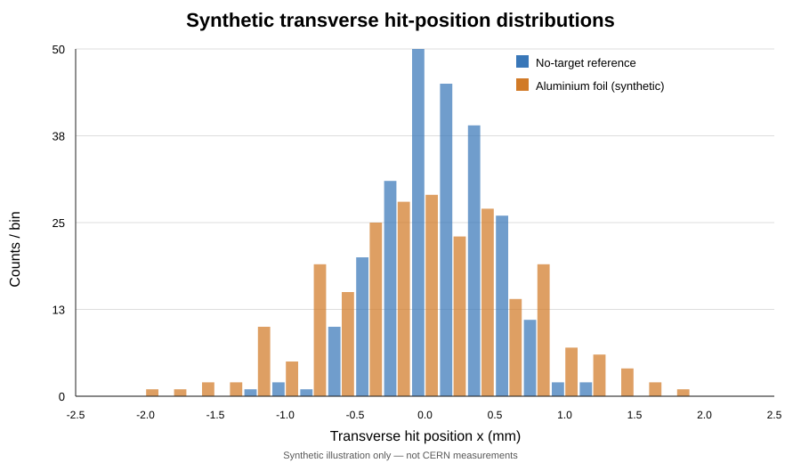
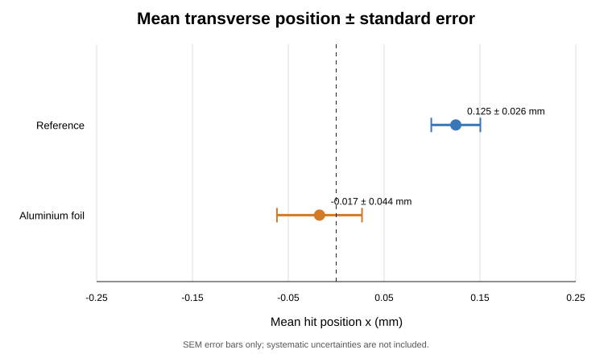

# CERN Beamline for Schools 2027 — Electron Scattering Study

This repository contains the student team's preparation work for the CERN Beamline for Schools (BL4S) 2027 competition.

## Current research direction

**Provisional concept:** measure how thin aluminium foils broaden the downstream transverse position distribution of a low-intensity CLEAR electron beam, using the CERN-listed Timepix3 detector.

This is a feasibility-stage concept, not a final experiment proposal. The detector geometry, foil mounting, beam configuration and event-separation strategy still require confirmation from the BL4S/CLEAR team.

## Scientific integrity

- No CERN beam time has taken place through this project.
- No real experimental data or measured result is claimed.
- The calculation in \`physics/scattering_estimates.py\` is an analytical first-order estimate, not a Geant4 simulation or a measurement.
- A single Timepix3 plane measures hit positions and timing; it does not by itself reconstruct an incoming and outgoing track or directly measure a scattering angle.
- The final BL4S proposal must be written and understood by the student team. CERN's 2027 feasibility guidance explicitly says not to use AI to write or generate the proposal. This repository is for learning, feasibility checks, reproducible calculations and planning—not a substitute for the team's own scientific reasoning or writing.

## Repository map

- \`docs/competition_requirements.md\` — verified BL4S 2027 requirements.
- \`docs/experiment_concept.md\` — provisional question, hypothesis, setup and variables.
- \`docs/feasibility_and_risks.md\` — CLEAR constraints, unresolved points and design risks.
- \`docs/data_analysis_plan.md\` — proposed data structure and analysis protocol.
- \`docs/questions_for_bl4s.md\` — technical questions to send to the organisers.
- \`docs/physics_basis.md\` — theoretical model and its limitations.
- \`physics/scattering_estimates.py\` — reproducible analytical estimates.
- \`tests/test_scattering_estimates.py\` — checks for the calculation.

## First local check

Run the calculation with Python 3:

    python physics/scattering_estimates.py

Run its tests:

    python -m unittest discover -s tests -v

The calculation uses only the Python standard library.

## Status

**Research stage:** initial CLEAR feasibility review documented.  
**Not yet complete:** official technical clarifications, detector/target geometry validation, full electron-transport simulation, data-acquisition rehearsal, team formation and the student-authored proposal.

See the documents in \`docs/\` before treating any proposed parameter or arrangement as fixed.

## Mahmut's software and simulation study

The software-study deliverables and honest completion status are tracked in `docs/mahmut_task_log.md`. Synthetic NumPy/Matplotlib examples are under `analysis/`, `data/synthetic/` and `figures/`. The PyROOT example is provided but requires a local ROOT installation to execute. Geant4, FLUKA/Flair, GATE/OpenGATE and phase-space interoperability notes are under `docs/`.

### Example analysis figures

These figures are generated from the clearly labelled synthetic CSV sample, not CERN measurements.
